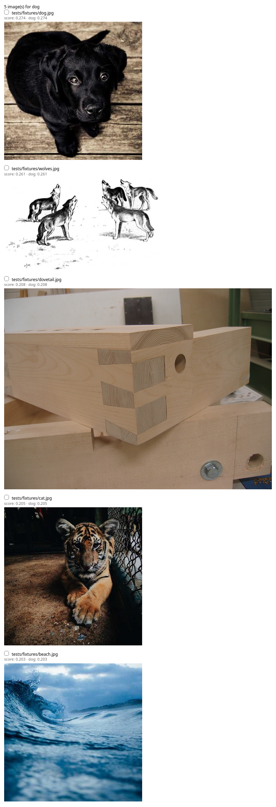

# grape

Search your photos by describing what's in them. Like grep, but for images.

```
$ grape -R -s -n 5 --keywords dog tests/fixtures
0.274  tests/fixtures/dog.jpg
0.261  tests/fixtures/wolves.jpg
0.208  tests/fixtures/dovetail.jpg
0.205  tests/fixtures/cat.jpg
0.203  tests/fixtures/beach.jpg
```

The same search with `--view`:



grape uses [CLIP](https://arxiv.org/abs/2103.00020)-style models, which
understand what a picture shows. "sunset" finds photos of sunsets, not
photos with the word "sunset" written in them.

## Install

```
pip install grape-image-search
```

Needs Python 3.10+. The first run downloads the model (~3.5 GB).

### GPU

grape uses a GPU if PyTorch can see one. Even a laptop's built-in GPU
reads photos ~20x faster than the CPU. `-v` shows which device it picked;
`GRAPE_DEVICE=cpu` forces the CPU.

- **NVIDIA**: the plain `pip install` above is all you need.
- **Intel**: install the GPU driver and PyTorch's Intel build first
  ([PyTorch's Intel GPU guide](https://docs.pytorch.org/docs/stable/notes/get_start_xpu.html)),
  or let `scripts/install_xpu.sh` set up a venv for you.

  ```
  pip install torch torchvision --index-url https://download.pytorch.org/whl/xpu
  pip install grape-image-search
  ```

- **AMD (untested)**: install PyTorch's ROCm build first
  ([pytorch.org](https://pytorch.org/get-started/locally/)).

## Searching

Give grape files or folders (`-R` to search folders), and say what you want:

```bash
# photos of something
grape -R --keywords sunset ~/Pictures

# several things at once (comma-separated; a photo's score is the average)
grape -R --keywords 'dog,beach' ~/Pictures

# photos that look like one you already have
grape -R --like my_dog.jpg ~/Pictures

# dogs, but not cats
grape -R --keywords dog --exclude cat ~/Pictures
```

The first search reads every photo, which takes a while. After that grape
remembers them, and searches take well under a second.

## Looking at the results

Results are listed best match first.

- `-n 10` shows only the top 10.
- `-s` shows each photo's score.
- `--view` opens the results in a window. Click photos to select them;
  when you close the window, grape prints the selected paths, ready to
  pass to another command:

  ```bash
  grape -R -n 200 --keywords blurry --view ~/Pictures | xargs rm --
  ```

> [!NOTE]
> When using `--view`, keep `-n` at 500 or less: the window gets slow
> with too many results.

## Using grape with other commands

Like grep, grape prints one path per line. `-print0` separates them with
NUL instead, which is safe for any filename:

```bash
# copy the 10 best cat photos to a folder
grape -R -print0 -n 10 --keywords cat ~/Pictures | xargs -0 cp -t ~/cats/

# search only this week's photos (- reads paths from stdin)
find ~/Pictures -mtime -7 -type f | grape --keywords selfie -
```

Run `grape --help` for every option.

## Scores

A score says how well a photo matches, on the model's own scale. Good
matches usually score 0.15-0.35; anything above 0.35 is rare. Scores only
compare photos within one search: a different model, or different
keywords, gives different numbers.

With `--exclude`, the score is the keyword score minus the exclude score.
That makes it useful for ranking photos by quality:

```bash
grape -R -n 20 --keywords 'beautiful photo' --exclude 'ugly photo' ~/Pictures
```

`--like` matches what a photo shows, not its exact pixels: two different
photos of a dog fetching a ball both score high. To find exact or
near-exact duplicates, use a tool built for that, like
[czkawka](https://github.com/qarmin/czkawka).

## Models

The default model is
[SigLIP 2](https://arxiv.org/abs/2502.14786)'s `ViT-L-16-SigLIP2-256`.
`--model` picks any [OpenCLIP](https://github.com/mlfoundations/open_clip)
model:

```bash
# smaller and faster
grape --model ViT-B-16-SigLIP2-256/webli -R --keywords sunset ~/Pictures

# bigger and slower, best matches
grape --model ViT-SO400M-14-SigLIP2/webli -R --keywords sunset ~/Pictures
```

`ViT-B-16-SigLIP2-256` reads photos about 3.5x faster and is a 1.5 GB
download instead of 3.5 GB. Its matches are slightly worse: on the standard
ImageNet test it names about 3 in 100 more photos wrong than the default.

Each model has its own index, so switching models reads all photos again.

## Cache

grape stores what it learns about each photo in
`~/.cache/grape/embeddings.db`, so it only reads a photo again after the
file changes. It also remembers files that aren't images (videos,
documents), so later searches skip them. `--cache PATH` uses a different
file; `--no-cache` turns caching off.

## Known issues

- `--view` can't display HEIC photos: the window's web engine doesn't
  decode them. Paths, scores and selection still work.
